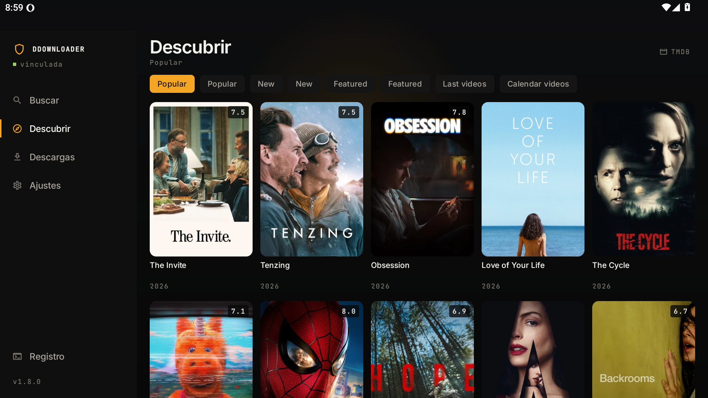

# DDownloader

Cliente de descargas para Android. Busca o pega un enlace y guarda el archivo en tu teléfono, con
reanudación y sin dejar el ordenador encendido.

## Para qué sirve

Convierte un enlace o un magnet en un archivo descargado, usando un servicio de debrid que prepara el
contenido y lo sirve por HTTPS. No descarga por P2P desde el teléfono: la app pide el enlace directo,
lo baja con reanudación y lo deja ordenado en la carpeta de descargas del sistema.

## Características

- **Búsqueda y catálogo**: filas de metadatos por categorías, o los catálogos de un add-on de
  catálogos configurable.
- **Varias fuentes de streams**: se consultan en paralelo y se unifican, cada resultado marcado con su
  origen.
- **Descarga desde debrid**: magnet o archivo torrent → enlace directo → archivo local.
- **Enlaces directos**: pega una URL `https` y descárgala sin cuenta.
- **Reanudable**: continúa donde se cortó, sobrevive al cierre de la app y a la pérdida de red.
- **Cola con estado**: progreso, velocidad, tiempo restante, reintentar y eliminar.
- **Carpeta nativa de descargas**: los archivos van a *Descargas/DDownloader*, con subcarpetas de
  películas y series listas para una biblioteca de medios.
- **Idiomas**: español e inglés, se cambia al instante.
- **Cuentas seguras**: los tokens se guardan cifrados con el Keystore de Android.
- **Actualizaciones dentro de la app**: verifica el hash y la firma antes de instalar.

## Instalación

1. Descarga el APK de la última versión publicada.
2. En el teléfono, permite instalar apps de esa fuente cuando el sistema lo pida
   (*Ajustes → Aplicaciones → Acceso especial → Instalar apps desconocidas*). Si aparece un aviso de
   seguridad por no venir de una tienda de aplicaciones, es normal: elige **Instalar de todos modos**.
3. Abre la app. El asistente inicial te pedirá, en orden:
   - vincular al menos una **cuenta de debrid** (te muestra un código corto y el enlace);
   - una **clave de API de metadatos** (gratuita, se obtiene en la web del servicio);
   - opcionalmente, otra carpeta de destino.
4. Listo. Busca un título o pega un magnet en **Buscar**. Los archivos quedan en
   `Descargas/DDownloader`.

**Requisitos:** Android 8.0 o superior.

## Notas

- Proyecto personal, sin tienda de aplicaciones; por eso el APK se instala manualmente.
- El debrid es necesario para torrents; los enlaces directos funcionan sin cuenta.
- Documentación técnica: `SPEC.md`, `DECISIONS.md`, `RELEASING.md`.
